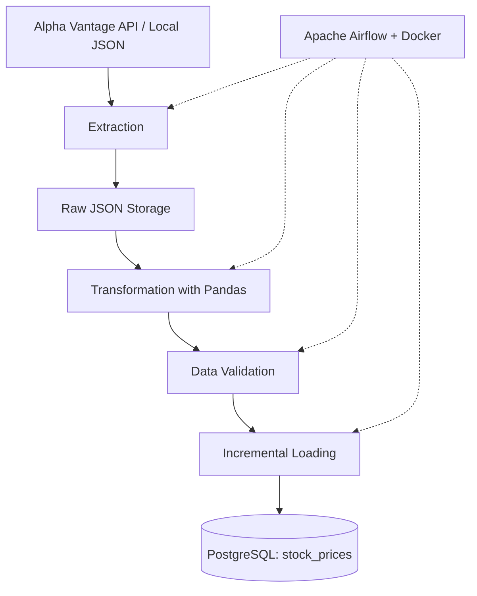
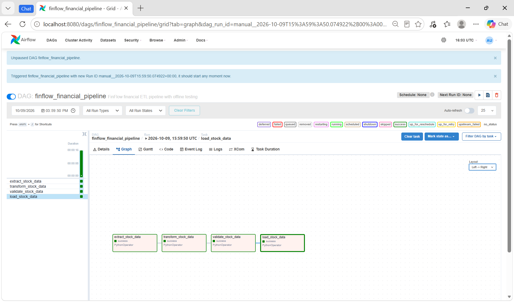
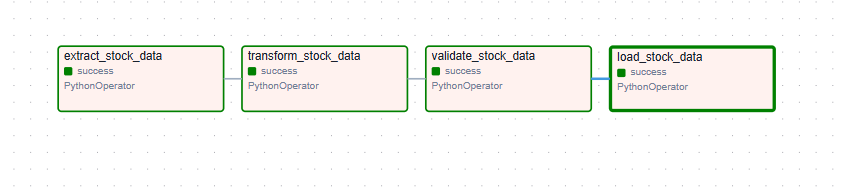

# FinFlow — Automated Financial Data Pipeline

An end-to-end financial data engineering project that extracts historical stock market data, transforms and validates records, and loads them into PostgreSQL using incremental loading.

The pipeline is orchestrated with Apache Airflow and runs locally using Docker.

## Project Overview

FinFlow demonstrates a practical ETL (Extract, Transform, Load) workflow for processing stock market data.

It focuses on:
- Building a modular Python ETL pipeline.
- Validating data quality before database loading.
- Implementing incremental loading with PostgreSQL UPSERT.
- Preventing unnecessary writes through change detection.
- Orchestrating ETL tasks with Apache Airflow.
- Testing workflows offline without consuming API requests.
- Monitoring pipeline execution through logs and Airflow.

## Architecture



### Pipeline Workflow

1. **Extraction:** Retrieves daily historical stock market data from Alpha Vantage or reads previously saved JSON in offline mode.
2. **Transformation:** Processes raw stock data into structured records using Pandas.
3. **Validation:** Checks the transformed dataset before loading.
4. **Loading:** Compares incoming records with existing PostgreSQL data and inserts or updates only when needed.

## Tech Stack

| Category | Technology |
|---|---|
| Programming | Python |
| Data Processing | Pandas |
| Database | PostgreSQL |
| Workflow Orchestration | Apache Airflow 2.11.2 |
| Containerization | Docker, Docker Compose |
| Data Source | Alpha Vantage API |
| Database Connectivity | pg8000 |
| Testing | Pytest |
| Configuration | python-dotenv |
| Version Control | Git, GitHub |

## Key Features

### Modular ETL Architecture

Extraction, transformation, validation, and loading are separated into reusable Python modules.

### Incremental Loading

FinFlow classifies incoming records into three categories:

- **NEW:** Records that do not exist in the database.
- **CHANGED:** Existing records with updated values.
- **UNCHANGED:** Records that match the existing database values.

Only new and changed records require database writes.

The PostgreSQL table uses a composite primary key consisting of `symbol` and `date`.

### Data Validation

Stock data is validated before entering the loading stage. Validation failures prevent the loading task from running successfully.

### Offline Testing

FinFlow supports two extraction modes:

- `offline`: Reads existing local JSON files without an API request.
- `live`: Retrieves stock data from Alpha Vantage.

The Airflow DAG currently defaults to offline mode for safe local testing.

### Logging and Error Handling

Pipeline activity is recorded through Python logging and Apache Airflow task logs.

## Apache Airflow Orchestration

The DAG `finflow_financial_pipeline` coordinates four PythonOperator tasks:

```text
extract_stock_data
        |
        v
transform_stock_data
        |
        v
validate_stock_data
        |
        v
load_stock_data
```

The current DAG is configured for manual execution using `schedule=None`.

### Airflow Dashboard



### Successful Pipeline Execution



All four tasks completed successfully during the offline pipeline test on October 9, 2026.

## Testing and Results

### Python Tests

The project includes tests for incremental loading classification and pipeline failure handling.

**Latest verified result: 6 tests passed.**

### Incremental Loading Test

The successful Airflow DAG run processed 100 existing Microsoft (MSFT) stock records.

| Metric | Result |
|---|---:|
| Records Checked | 100 |
| New Records | 0 |
| Changed Records | 0 |
| Unchanged Records | 100 |
| Task Status | SUCCESS |

This confirms that the incremental loading implementation skips unnecessary writes when the incoming dataset matches the database.

### Database

The local PostgreSQL database was verified to contain:

| Symbol | Records |
|---|---:|
| AAPL | 100 |
| MSFT | 100 |
| **Total** | **200** |

These figures represent the verified local development dataset, not a continuously updated production database.

## Project Structure

```text
FinFlow/
├── airflow/
│   ├── dags/
│   │   └── finflow_pipeline.py
│   ├── Dockerfile
│   └── docker-compose.yaml
├── data/
│   ├── raw/
│   └── processed/
├── docs/
│   └── screenshots/
│       ├── airflow-dashboard.png
│       └── airflow-pipeline-success.png
├── logs/
├── sql/
├── src/
│   ├── extraction/
│   │   ├── extract_stock.py
│   │   └── extract_offline.py
│   ├── transformation/
│   │   └── transform_stock.py
│   ├── validation/
│   │   └── validate_stock.py
│   ├── loading/
│   │   ├── incremental.py
│   │   └── load_stock.py
│   └── logger.py
├── tests/
├── .env.example
├── .gitignore
├── config.py
├── main.py
├── requirements.txt
└── README.md
```

## Local Setup

### Prerequisites

- Python
- PostgreSQL
- Docker Desktop
- Docker Compose
- Alpha Vantage API key (required for live extraction only)

### 1. Clone the Repository

```bash
git clone <your-repository-url>
cd FinFlow
```

### 2. Create a Virtual Environment

```bash
python -m venv .venv
```

Activate the environment on Windows PowerShell:

```powershell
.\.venv\Scripts\Activate.ps1
```

### 3. Install Dependencies

```bash
pip install -r requirements.txt
```

### 4. Configure Environment Variables

Copy `.env.example` to `.env` and provide the required API and PostgreSQL credentials.

Never commit `.env` or real credentials to GitHub.

### 5. Prepare PostgreSQL

Create the `finflow_db` database and initialize the `stock_prices` table using the project's SQL schema.

### 6. Run the Python Pipeline

```bash
python main.py
```

The current `main.py` configuration processes MSFT.

This command uses the live extraction function and may consume an Alpha Vantage API request.

### 7. Start Apache Airflow

```bash
docker compose -f airflow/docker-compose.yaml up -d --build
```

Open:

http://localhost:8080

Log in using the credentials generated by Airflow standalone.

### 8. Run the Airflow Pipeline

1. Open `finflow_financial_pipeline`.
2. Confirm the extraction mode in `airflow/dags/finflow_pipeline.py`.
3. Trigger the DAG manually.
4. Monitor the four tasks in Graph view.
5. Inspect task logs to verify loading statistics.

The default offline mode requires an existing raw JSON file for MSFT.

## Future Improvements

- Add controlled scheduling with API rate-limit awareness.
- Expand stock symbol coverage.
- Introduce pipeline alerting and operational monitoring.
- Add additional data quality checks.
- Improve deployment configuration for production environments.
- Expand automated integration testing.

## Project Status

**Local development / portfolio project**

The modular Python pipeline, PostgreSQL incremental loading, Airflow orchestration, and offline end-to-end execution have been successfully tested.

Production deployment and automated scheduling are future improvements.
